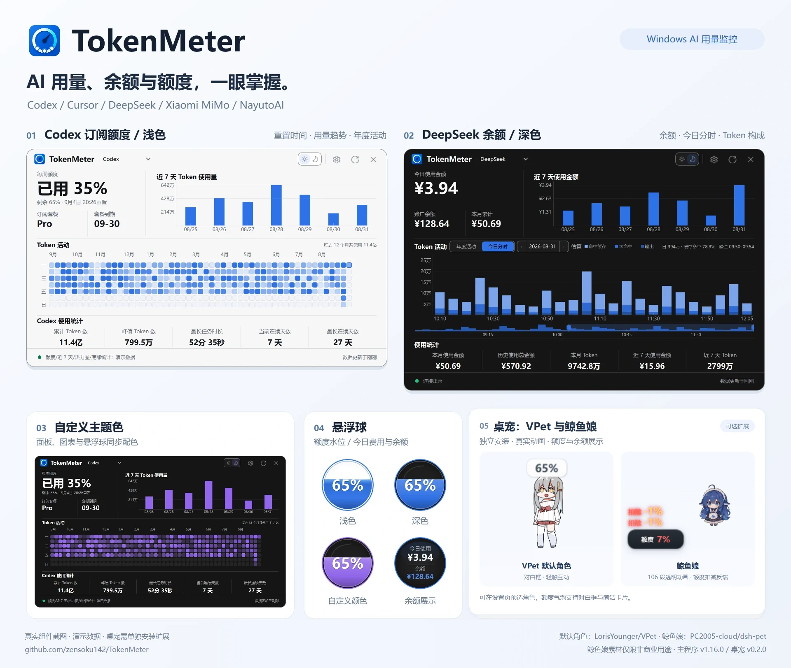
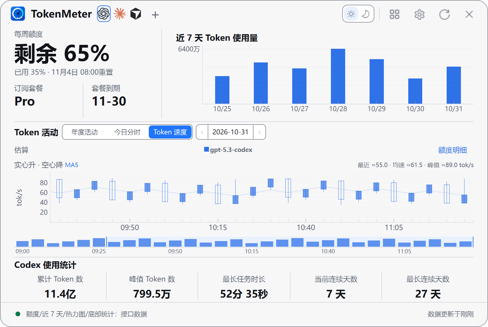
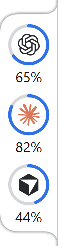

<p align="center">
  <a href="./README.md">简体中文</a> |
  <a href="./README.en.md">English</a> |
  <a href="./README.zh-TW.md">繁體中文</a> |
  <a href="./README.ja.md">日本語</a> |
  <a href="./README.ko.md">한국어</a>
</p>

# TokenMeter — Windows AI Token Usage & Subscription Quota Monitor

<p align="center">
  <a href="https://github.com/zensoku142/TokenMeter/stargazers"></a>
  <a href="https://github.com/zensoku142/TokenMeter/releases/latest"></a>
  <a href="https://github.com/zensoku142/TokenMeter/releases"></a>
  <a href="https://github.com/zensoku142/TokenMeter/actions/workflows/ci.yml"></a>
</p>

<p align="center">
  <a href="https://github.com/zensoku142/TokenMeter/releases/latest"><strong>Download latest</strong></a> ·
  <a href="https://github.com/zensoku142/TokenMeter/stargazers">Star the project</a> ·
  <a href="https://github.com/zensoku142/TokenMeter/discussions">Feedback & discussions</a>
</p>

<p align="center">
  <strong>AI Token Usage, Cost & Balance Monitor for Windows</strong><br>
  <sub>Codex · Claude · Cursor · DeepSeek · MiMo · NayutoAI</sub>
</p>

TokenMeter is a lightweight AI usage monitor for Windows 10/11. Track subscription quotas, reset times, API costs, balances and history across 6 providers, with a floating widget, light ring or desktop pet.

<table>
  <tr>
    <td align="center" width="46%"><a href="docs/images/readme-hero.webp"></a><br>Product overview</td>
    <td align="center" width="46%"><a href="site/assets/panel-token-speed.png"></a><br>Token speed</td>
    <td align="center" width="8%"><a href="site/assets/light-ring.png"></a><br>Light ring</td>
  </tr>
</table>

Actual component screenshots in Chinese with demo data; click to enlarge. [Images and sources](docs/images/readme/README.md).

Current version：**v1.17.1** · Pet **v0.3.2** · [GitHub Pages](https://zensoku142.github.io/TokenMeter/)

## Features

- **Quotas and balances**: Codex / Claude Code / Cursor quotas; DeepSeek / MiMo / NayutoAI costs, balances and history. Currencies, credits and tokens stay separate.
- **Analytics and speed**: Codex intraday usage; local Codex / Claude / ZCode statistics, filters and Excel export. Codex / NayutoAI also show model output speed.
- **Overview and accounts**: multi-provider overview and an always-on-top two-provider dashboard. Multi-account is off by default; independent monitoring preserves default connections and CLI logins.
- **CC Switch**: enable multi-account and the CC connection to discover and refresh managed Codex OAuth accounts. CC handles renewal and queries; disconnects retain cached quotas.
- **Floating displays**: quota/balance widget or light ring, with dragging, resizing and edge docking. The ring supports multiple providers/accounts, ordering, colors and width adjustment.
- **Refresh and alerts**: background sync, retry backoff, offline cache, peak/off-peak hints and Cookie collection; optional low-quota, recovery, forecast and Codex reset-news alerts, with quiet hours.
- **Appearance and integration**: light/dark/system themes, colors, opacity, five languages, provider search/favorites, startup, automatic updates and data migration.

Local logs have unknown account attribution and are not quotas or bills. Speed estimates include first-token wait; insufficient data stays unknown. Community reset news does not confirm a personal reset.

<details>
<summary>Controls and connection details</summary>

- Drag the ring to move it, hold an icon then drag vertically to reorder, and use Ctrl + wheel to adjust width. Select sources in Usage → Background providers.
- Multi-account and CC connections can be disabled separately without losing configuration. The CC bridge uses internal commands; if CC is running without it, exit fully from the tray once before refreshing. Independent multi-account login/renewal requires CC setup.
- Forecasts require 10 minutes of valid samples in the same cycle; recovery alerts require low-quota alerts and a confirmed refresh. Alert state survives restarts; removing a connection preserves CLI logins and history.

</details>

## Installation and setup

Requires Windows 10 / 11 and at least one supported account.

1. Download and run `TokenMeter-Setup-vX.Y.Z-x64.exe` from [GitHub Releases](https://github.com/zensoku142/TokenMeter/releases/latest). Checksums are in `SHA256SUMS.txt`.
2. Click the floating widget and select a provider in Settings. Codex / Cursor can read local login data; enter DeepSeek credentials or an optional API key, use MiMo's Cookie collection, or enter NayutoAI credentials.
3. Settings save automatically; the default refresh interval is 60 seconds. Appearance contains theme and language options; Floating & Startup contains launch and edge behavior.

> Data depends on platform endpoints and login state. API or risk-control changes may interrupt collection. Use only your own credentials.

## Desktop pet (optional)

<table>
  <tr>
    <td align="center" width="33%"><a href="docs/images/readme/pet-vpet-current.png"></a><br>Loris (VPet)</td>
    <td align="center" width="33%"><a href="site/assets/pet-whale-transparent.png"></a><br>Whale Girl</td>
    <td align="center" width="34%"><a href="site/assets/pet-bailong.png"></a><br>Xiaolong</td>
  </tr>
</table>

Download and enable characters in Settings → Pet; no separate .NET is needed. Replace the floating widget or show both; disabling restores the widget.

- **Characters**: Loris (VPet) offers idle, walking and interactions; [Whale Girl](https://github.com/PC2005-cloud/dsh-pet) adds quota feedback and balance cards; [Xiaolong](pet_host/bailong/README.md) has 35 animations and autonomous movement.
- **Controls**: dragging, Ctrl + wheel resizing, theme-aware quota bubbles and water/break reminders (off by default). Double-click a bubble to open the panel; multiple pets save positions and display accounts independently.
- **Management**: install/remove characters separately, choose a default and update independently via stable/preview channels. Removing the last character removes the host; pets exit with the app.

Sizes: Xiaolong 80–320, others 160–320. Pet menus are in Chinese. No progression, feeding, work, Steam, online features or AI chat. Whale Girl assets are non-commercial only. [Development](pet_host/README.md) · [Sources and licensing](pet_host/THIRD_PARTY_NOTICES.md).

## Data, privacy, and updates

- Data defaults to `install directory\data` and can be moved in Settings. Legacy migration copies data and preserves the original directory; history is cached in local SQLite.
- API keys, Bearer tokens, and Cookies are stored in Windows Credential Manager, not configuration files or logs. The pet receives display fields only, never credentials.
- Updates verify SHA256 and preserve data and shortcuts. Uninstall also keeps `data`; remove it manually only when no longer needed. A checksum is not a release signature.

## Run from source

Requires Python 3.11+. Source and installed builds share a single-instance limit; exit any running TokenMeter first.

```powershell
git clone https://github.com/zensoku142/TokenMeter.git
cd TokenMeter
python -m venv .venv
.\.venv\Scripts\Activate.ps1
python -m pip install --upgrade "pip>=26.1.2"
python -m pip install -r requirements.txt
python main.py
```

<details>
<summary>Development, tests, and builds</summary>

```powershell
python -m pip install -r requirements-dev.txt
python -m pytest -q
python -m ruff check .
pyright
python -m pip install -r requirements-build.txt
python scripts/build_release.py
```

Qt tests need an available Windows desktop session; installer builds require Inno Setup. Pet builds require .NET SDK 8+; see [pet development](pet_host/README.md).

[Project structure](docs/PROJECT_STRUCTURE.md) · [Example configuration](examples/config.example.py) (do not copy it to `config.py`)

</details>

## Troubleshooting

- No window: check the system tray and avoid starting a second instance.
- Expired credentials or rate limits: renew the login / Cookie, or wait before refreshing.
- Data problems: inspect `TokenSpider.log` in the active data directory; remove sensitive information before reporting an issue.

## Versions

Main app: `1.17.1`; optional pet extension: `0.3.2`. See [GitHub Releases](https://github.com/zensoku142/TokenMeter/releases) for changes and checksums.

## License and acknowledgments

TokenMeter's own code uses the [MIT License](LICENSE).

The pet core, default character, and animations come from [LorisYounger/VPet](https://github.com/LorisYounger/VPet). Thanks to its authors and contributors. The core uses [Apache-2.0](third_party/VPet/LICENSE); the character and animations are copyrighted by 虚拟主播模拟器制作组 and have separate terms, outside TokenMeter's MIT license. See the [third-party notices](pet_host/THIRD_PARTY_NOTICES.md).
