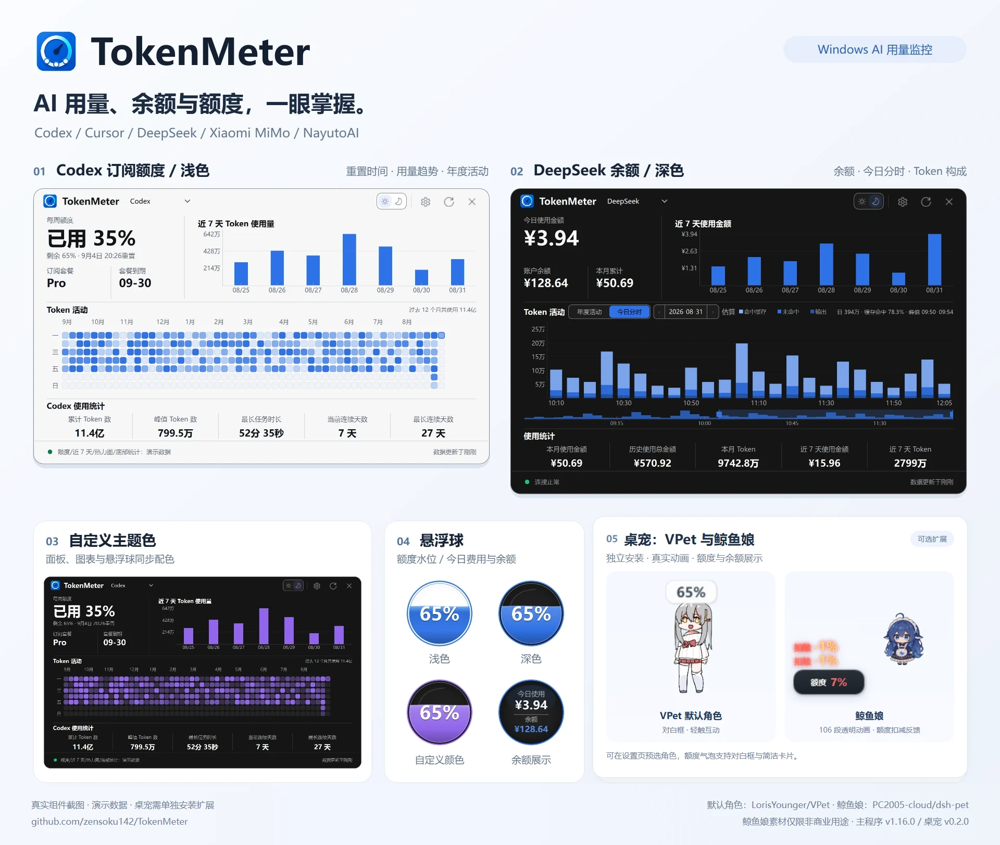
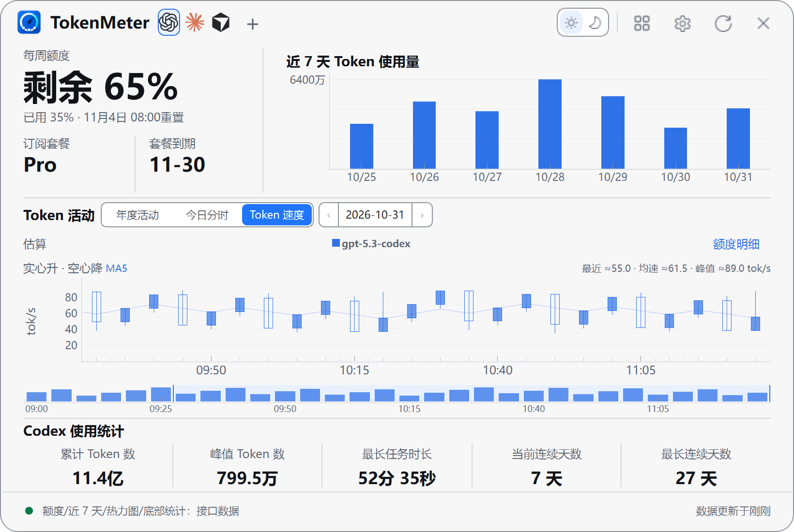
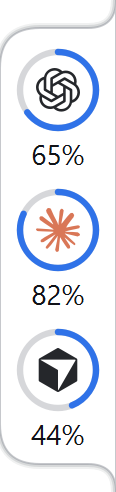

<p align="center">
  <a href="./README.md">简体中文</a> |
  <a href="./README.en.md">English</a> |
  <a href="./README.zh-TW.md">繁體中文</a> |
  <a href="./README.ja.md">日本語</a> |
  <a href="./README.ko.md">한국어</a>
</p>

# TokenMeter — Windows 向け AI Token 使用量・サブスクリプション枠モニター

<p align="center">
  <a href="https://github.com/zensoku142/TokenMeter/stargazers"></a>
  <a href="https://github.com/zensoku142/TokenMeter/releases/latest"></a>
  <a href="https://github.com/zensoku142/TokenMeter/releases"></a>
  <a href="https://github.com/zensoku142/TokenMeter/actions/workflows/ci.yml"></a>
</p>

<p align="center">
  <a href="https://github.com/zensoku142/TokenMeter/releases/latest"><strong>最新版をダウンロード</strong></a> ·
  <a href="https://github.com/zensoku142/TokenMeter/stargazers">Star で応援</a> ·
  <a href="https://github.com/zensoku142/TokenMeter/discussions">フィードバックと議論</a>
</p>

<p align="center">
  <strong>Windows 向け AI Token 使用量・コスト・残高モニター</strong><br>
  <sub>Codex · Claude · Cursor · DeepSeek · MiMo · NayutoAI</sub>
</p>

<p align="center">
  <a href="docs/images/readme-hero.webp"></a>
</p>

製品の全体像として、使用量パネル、フローティングウィジェット、VPet と鯨の少女を紹介しています。Token 速度、ライトリング、小龍娘の画像は下の各項目に掲載しています。いずれも実際のコンポーネントを撮影した画面で、表示は中国語、数値はデモデータです。[元画像と出典](docs/images/readme/README.md)。

TokenMeter は Windows 10/11 向けの軽量な AI 使用量モニターです。6 つの独立した接続先を備え、各サービスの対応範囲に応じて契約の利用枠、リセット時刻、API コスト、残高と履歴を表示します。フローティングウィジェット、ライトリング、ペットで使用量を常時確認でき、パネルでは時間帯別の統計、Token 速度、複数アカウントの利用枠も確認できます。

現在のバージョン：**v1.17.1** · ペット **v0.3.2** · [GitHub Pages](https://zensoku142.github.io/TokenMeter/)


## 機能

- **CC Switch の Codex 複数アカウント**：「設定 → 複数アカウント」で複数アカウント機能と CC Switch 連携を有効にすると、アプリの起動時から CC Switch 管理の Codex OAuth アカウントを自動検出・更新します。トークン更新と照会は CC Switch が行い、切断時はキャッシュした利用枠を表示します。ローカル連携は CC Switch の内部コマンドに依存し、バージョン変更への対応が必要になる場合があります。連携なしで起動中の場合は一度トレイから完全終了してから更新してください。
- **ライトリングと Codex リセット情報**：フローティングウィジェットに加え、単一・複数サービスや複数アカウントを常時表示するライトリングを選べます。画面端への吸着とリング色の変更に対応。アイコンや余白をドラッグするとウィンドウを移動でき、アイコンを長押ししてから上下にドラッグすると並べ替えられます。順序は自動保存され、ホバー中に Ctrl を押しながらホイールを回すと幅を調整できます。ホバー詳細にはコミュニティの公開リセット情報を表示でき、通知も選択できます。公開情報は個人アカウントのリセットを保証しません。表示元は「取得と統計 → バックグラウンド取得」で選択します。
- **Codex の時間別使用量**：ローカルセッションログの記録時刻ごとにキャッシュ入力、新規入力、出力 Token を表示。モデルのツールチップ、保存済み日付と差分更新に対応します。選択したローカルディレクトリのみを集計し、アカウント帰属は不明です。契約の利用枠や実際の請求額ではありません。
- **Token 速度**：Codex と NayutoAI のパネルで、モデルと時刻ごとの出力速度を確認できます。有効なリクエストの出力 Token と所要時間から推定し、最初の応答待ち時間も含みます。データが不足する場合は不明と表示します。
- **利用枠と残高**：Codex、Claude Code、Cursor の利用枠、DeepSeek / MiMo / NayutoAI の使用量と残高に対応。未提供の値は利用不可とし、クレジット、通貨、トークンは分けて表示します。
- **一覧と複数アカウント**：一覧の表示中は設定済みサービスを自動更新。複数アカウント機能は既定でオフです。「設定 → 複数アカウント」で有効にすると接続・認証情報・監視状態を個別管理でき、既定の接続や CLI ログインを上書きしません。無効にすると全プロファイルの収集と表示を停止します。CC Switch 連携だけを無効にして接続と自動起動を停止することもでき、再度有効にすると保存済みの設定を引き継ぎます。設定済みの 2 サービスを最前面の小型ダッシュボードにも表示できます。
- **ローカル統計と Excel**：Codex（アーカイブを含む）と Claude のローカルログを読み取り、キャッシュを先に表示してバックグラウンド更新。日付・プロジェクト・モデルの絞り込み、日別比較、グラフのズーム、集計・明細・集計基準の `.xlsx` 出力に対応。ログのアカウント帰属は不明で、契約の残量や実際の請求額ではありません。アクセス可能な WSL ディレクトリも選択できますが WSL は起動しません。
- **接続先管理**：オフラインのブランドアイコン、検索、お気に入り、アプリが保存した接続の削除。CLI ログインと履歴は保持します。
- **更新と通知**：失敗時の更新間隔延長、オフラインキャッシュ、任意の残量低下・回復通知、消費予測と通知休止時間。予測には同じ周期の有効なサンプルが 10 分以上必要です。回復通知は残量低下通知が有効で、取得結果で回復を確認した場合に送ります。通知状態は再起動後も保持します。
- **デスクトップ表示**：フローティングウィジェットは利用枠を水位表示、または残高を数値表示し、ドラッグ、ホイールによるサイズ変更、画面端での非表示、トレイ常駐に対応します。明暗・システムテーマ、色と透明度、5 言語、自動更新、任意の複数キャラクターペットも利用できます。アプリ v1.17.0 とペット v0.3.1 の組み合わせで利用枠ウィンドウのテーマを同期します。

<p align="center">
  <a href="site/assets/panel-token-speed.png"></a>
</p>

Token 速度パネルではモデルの出力速度の推移を確認でき、従来の利用枠、残高、時間帯別統計と合わせて使えます。

<p align="center">
  <a href="site/assets/light-ring.png"></a>
</p>

ライトリングは複数サービスをコンパクトに常時表示します。従来のフローティングウィジェットも設定から選択できます。

## インストールと設定

Windows 10 / 11 と、対応サービスのアカウントが 1 つ以上必要です。

1. [GitHub Releases](https://github.com/zensoku142/TokenMeter/releases/latest) から `TokenMeter-Setup-vX.Y.Z-x64.exe` をダウンロードしてインストールします。チェックサムは `SHA256SUMS.txt` にあります。
2. フローティングウィジェットをクリックし、「設定」でサービスを選択します。Codex / Cursor はローカルのログイン情報を利用できます。DeepSeek は資格情報または任意の API Key、MiMo は Cookie 取得機能、NayutoAI は専用の資格情報を使用します。
3. 設定は自動保存され、既定の更新間隔は 60 秒です。テーマと言語は「外観」、起動と画面端の動作はフローティング・起動設定で変更できます。

> データはサービスの API とログイン状態に依存します。API やアクセス制限の変更で取得できなくなる場合があります。自分の資格情報のみを使用してください。

## デスクトップペット（任意）

本体のインストーラーにペットは含まれません。「設定 → ペット」で拡張をダウンロードし、インストール完了後に有効にします。.NET の別途インストールは不要です。ペットは既定でフローティングウィジェットを置き換えます。「フローティングボールも表示」を有効にすると両方を表示でき、設定は自動保存されてすぐに反映されます。ペットを無効化・削除すると元に戻り、アカウントやパネルには影響しません。

- タッチ操作、ドラッグ、サイズ変更、自律動作、画面端の残量バブルに対応。バブルをダブルクリックすると使用量パネルが開きます。
- 起動前に標準の VPet キャラクター（Loris）、[鯨の少女](https://github.com/PC2005-cloud/dsh-pet)、[小龍娘](pet_host/bailong/README.md)を選べます。Loris は待機・歩行・インタラクションに対応し、鯨の少女は各種アニメーション、利用枠の減少演出、残高カードを備えています。鯨の少女の素材は非商用利用に限られます。小龍娘は全 35 種のアニメーションと自律動作・移動に対応し、既存のホスト、利用枠バブル、表示元の選択、複数起動を共有します。AI チャットや会話履歴は含みません。設定画面にはキャラクターの縮小画像とインストール可能な互換バージョンを表示し、インストール済みのキャラクターを既定に設定できます。
- 選んだキャラクターだけをダウンロードでき、後から VPet、鯨の少女、小龍娘の素材を個別に追加・削除できます。最後のキャラクターを削除すると共通ホストも削除します。ペットの更新は安定版・プレビュー版のチャンネルを個別に選択できます。
- ペットの右クリックメニューからインストール済みキャラクターを追加起動したり、1 体だけ終了したりできます。追加したペットは位置を個別に保存し、各ペットの表示元として本体の現在のサービス、設定済みサービスの既定アカウント、保存済みのアカウントプロファイルを選べます。
- ペットにマウスを重ね、Ctrl を押しながらホイールを回すとサイズを変更できます。小龍娘は 80–320、ほかのキャラクターは 160–320 に対応します。
- 右クリックメニューでバブルの表示方法や、水分補給・休憩のリマインダーを設定できます。リマインダーは既定でオフ、ペットのメニューは現在中国語のみです。
- 軽量版には給餌、仕事、育成、Steam、オンライン機能はありません。拡張は単独で更新でき、本体と同時に終了します。

実装とビルドは [ペット開発ガイド](pet_host/README.md)、素材の利用条件は [出典とライセンス](pet_host/THIRD_PARTY_NOTICES.md) を参照してください。


鯨の少女の素材出典：[PC2005-cloud/dsh-pet](https://github.com/PC2005-cloud/dsh-pet)。非商用利用に限られます。

<p align="center">
  <a href="site/assets/pet-bailong.png"></a>
</p>

小龍娘は VPet や鯨の少女と同じ画面からインストール・切り替えができ、個別にダウンロードできます。アニメーションと素材の詳細は[小龍娘の紹介](pet_host/bailong/README.md)を参照してください。

## データ、プライバシー、更新

- データは既定で `インストール先\data` に保存され、設定から移行できます。旧版からの移行はコピー方式で元のディレクトリを保持し、履歴はローカル SQLite に保存します。
- API Key、Bearer Token、Cookie は Windows 資格情報マネージャーに保存し、設定ファイルやログには記録しません。ペットには表示用データのみを渡し、資格情報は渡しません。
- 更新は SHA256 検証後に適用し、データとショートカットを保持します。アンインストールでも `data` は残るため、不要と確認してから手動で削除してください。チェックサムはリリース署名とは異なります。

## ソースから実行

Python 3.11+ が必要です。ソース版とインストール版は同時に起動できないため、実行中の TokenMeter を先に終了してください。

```powershell
git clone https://github.com/zensoku142/TokenMeter.git
cd TokenMeter
python -m venv .venv
.\.venv\Scripts\Activate.ps1
python -m pip install --upgrade "pip>=26.1.2"
python -m pip install -r requirements.txt
python main.py
```

<details>
<summary>開発・テスト・ビルド</summary>

```powershell
python -m pip install -r requirements-dev.txt
python -m pytest -q
python -m ruff check .
pyright
python -m pip install -r requirements-build.txt
python scripts/build_release.py
```

Qt テストには利用可能な Windows デスクトップセッション、インストーラー生成には Inno Setup が必要です。ペットのビルドには .NET SDK 8+ が必要です。[ペット開発ガイド](pet_host/README.md) を参照してください。

[プロジェクト構成](docs/PROJECT_STRUCTURE.md) · [設定例](examples/config.example.py)（`config.py` へのコピーは不要）

</details>

## トラブルシューティング

- ウィンドウがない：システムトレイと二重起動を確認してください。
- 資格情報の期限切れ・アクセス制限：ログインや Cookie を更新するか、時間を置いて再試行してください。
- データの問題：現在のデータディレクトリにある `TokenSpider.log` を確認し、報告前に機密情報を除去してください。

## バージョン

本体 `1.17.1`、任意のペット拡張 `0.3.2`。変更履歴とチェックサムは [GitHub Releases](https://github.com/zensoku142/TokenMeter/releases) にあります。

## ライセンスと謝辞

TokenMeter 独自のコードは [MIT License](LICENSE) で提供します。

ペットのコア、既定のキャラクター、アニメーションは [LorisYounger/VPet](https://github.com/LorisYounger/VPet) に由来します。作者と貢献者の皆様に感謝します。コアは [Apache-2.0](third_party/VPet/LICENSE) です。キャラクターとアニメーションの著作権は虚拟主播模拟器制作组に帰属し、別の利用条件が適用されるため、本プロジェクトの MIT ライセンスには含まれません。[第三者の権利に関する声明](pet_host/THIRD_PARTY_NOTICES.md) を参照してください。
