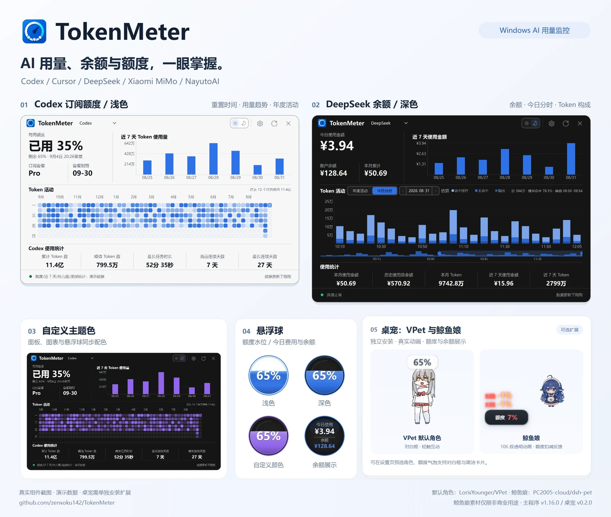
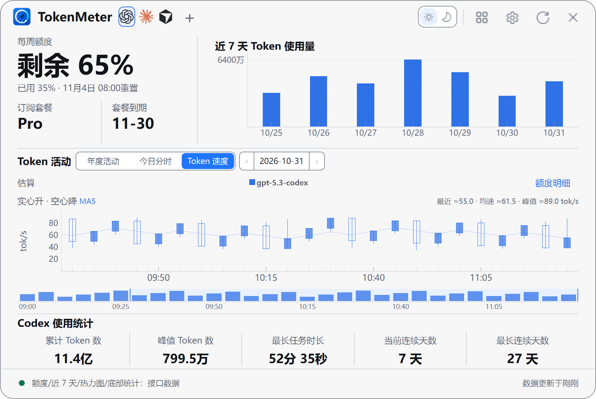
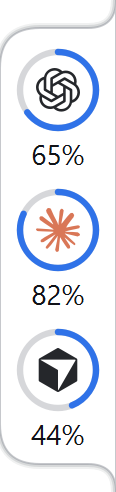

<p align="center">
  <a href="./README.md">简体中文</a> |
  <a href="./README.en.md">English</a> |
  <a href="./README.zh-TW.md">繁體中文</a> |
  <a href="./README.ja.md">日本語</a> |
  <a href="./README.ko.md">한국어</a>
</p>

# TokenMeter — Windows AI Token 사용량 및 구독 한도 모니터

<p align="center">
  <a href="https://github.com/zensoku142/TokenMeter/stargazers"></a>
  <a href="https://github.com/zensoku142/TokenMeter/releases/latest"></a>
  <a href="https://github.com/zensoku142/TokenMeter/releases"></a>
  <a href="https://github.com/zensoku142/TokenMeter/actions/workflows/ci.yml"></a>
</p>

<p align="center">
  <a href="https://github.com/zensoku142/TokenMeter/releases/latest"><strong>최신 버전 다운로드</strong></a> ·
  <a href="https://github.com/zensoku142/TokenMeter/stargazers">Star로 응원하기</a> ·
  <a href="https://github.com/zensoku142/TokenMeter/discussions">피드백 및 토론</a>
</p>

<p align="center">
  <strong>Windows용 AI Token 사용량, 비용 및 잔액 모니터</strong><br>
  <sub>Codex · Claude · Cursor · DeepSeek · MiMo · NayutoAI</sub>
</p>

<p align="center">
  <a href="docs/images/readme-hero.webp"></a>
</p>

제품 개요에는 사용량 패널, 플로팅 위젯, VPet과 고래 소녀가 표시됩니다. Token 속도, 라이트 링과 샤오룽 이미지는 아래 해당 항목에서 볼 수 있습니다. 모두 실제 컴포넌트 화면이며 중국어 UI와 데모 데이터를 사용했습니다. [원본 이미지와 출처](docs/images/readme/README.md).

TokenMeter는 Windows 10/11용 경량 AI 사용량 모니터입니다. 독립적인 플랫폼 연결 6개를 제공하며 각 플랫폼의 지원 범위에 따라 구독 한도, 초기화 시간, API 비용, 잔액과 기록을 표시합니다. 플로팅 위젯, 라이트 링이나 데스크톱 펫으로 사용량을 계속 확인하고, 패널을 열어 시간대별 통계, Token 속도와 다중 계정 한도를 볼 수 있습니다.

현재 버전：**v1.17.1** · 펫 **v0.3.2** · [GitHub Pages](https://zensoku142.github.io/TokenMeter/)


## 기능

- **CC Switch Codex 다중 계정**: 설정 → 다중 계정에서 다중 계정 기능과 CC Switch 연결을 활성화하면 앱 시작 시부터 CC Switch가 관리하는 Codex OAuth 계정을 자동으로 찾아 갱신합니다. 토큰 갱신과 조회는 CC Switch가 처리하며 연결이 끊겨도 캐시된 한도를 표시합니다. 로컬 연동은 CC Switch 내부 명령에 의존하므로 버전 변경에 따른 수정이 필요할 수 있습니다. 연동 없이 실행 중이면 트레이에서 완전히 종료한 뒤 새로 고치세요.
- **라이트 링과 Codex 초기화 소식**: 플로팅 위젯 외에 라이트 링을 선택해 단일·다중 플랫폼과 여러 계정을 계속 표시할 수 있습니다. 가장자리 고정과 링 색상 변경을 지원합니다. 아이콘이나 빈 공간을 드래그하면 창이 이동하며, 아이콘을 길게 누른 뒤 위아래로 드래그하면 순서가 바뀌고 자동 저장됩니다. 마우스를 올린 상태에서 Ctrl을 누르고 휠을 돌리면 너비를 조절합니다. 커뮤니티 공개 초기화 소식을 볼 수 있고 알림을 켤 수 있지만, 공개 소식은 개인 계정의 초기화를 보장하지 않습니다. 표시할 계정과 플랫폼은 「수집 및 통계 → 백그라운드 제공자」에서 선택합니다.
- **Codex 시간대별 사용량**: 로컬 세션 로그의 기록 시간별로 캐시 입력, 신규 입력 및 출력 Token을 표시하며 모델 툴팁, 보관 날짜와 증분 갱신을 지원합니다. 선택한 로컬 디렉터리만 집계하며 계정 소속은 알 수 없습니다. 구독 한도나 실제 청구액이 아닙니다.
- **Token 속도**: Codex와 NayutoAI 패널에서 모델과 시간별 출력 속도를 확인합니다. 유효한 요청의 출력 Token과 소요 시간으로 추정하며 첫 토큰 대기 시간을 포함합니다. 데이터가 부족하면 알 수 없음으로 표시합니다.
- **한도와 잔액**: Codex, Claude Code, Cursor 한도, DeepSeek / MiMo / NayutoAI 사용량과 잔액을 지원합니다. 누락된 값은 사용 불가로 표시하며 크레딧, 통화, 토큰을 구분합니다.
- **개요와 다중 계정**: 개요가 보이는 동안 설정된 플랫폼을 자동 갱신합니다. 다중 계정 기능은 기본적으로 꺼져 있습니다. 설정 → 다중 계정에서 활성화하면 연결·자격 증명·모니터링 상태를 각각 저장하며 기본 연결이나 CLI 로그인을 덮어쓰지 않습니다. 다중 계정 기능을 끄면 모든 프로필의 수집과 표시가 중지됩니다. CC Switch 연결만 별도로 꺼서 연결과 자동 실행을 중지할 수도 있으며, 다시 켜면 저장된 설정을 사용합니다. 설정한 두 플랫폼을 항상 위에 표시되는 작은 대시보드로 볼 수도 있습니다.
- **로컬 통계와 Excel**: Codex(보관 세션 포함)와 Claude 로컬 로그를 읽고 캐시를 먼저 표시한 뒤 백그라운드에서 갱신합니다. 날짜·프로젝트·모델 필터, 일별 비교, 차트 확대·축소와 요약·상세·집계 기준의 `.xlsx` 내보내기를 지원합니다. 로그의 계정 소속은 알 수 없으며 구독 한도나 실제 청구액이 아닙니다. 접근 가능한 WSL 디렉터리는 선택할 수 있지만 WSL을 시작하지 않습니다.
- **플랫폼 관리**: 오프라인 브랜드 아이콘, 검색, 즐겨찾기와 앱에 저장된 연결 삭제를 제공합니다. CLI 로그인과 기록은 유지합니다.
- **갱신과 알림**: 실패 시 갱신 간격 증가, 오프라인 캐시, 선택적 한도 부족·회복 알림, 소진 예측과 방해 금지 시간을 지원합니다. 예측에는 같은 주기의 유효한 표본이 10분 이상 필요합니다. 회복 알림은 한도 부족 알림을 켜고 갱신으로 회복을 확인한 경우에 보냅니다. 알림 상태는 재시작 후에도 유지됩니다.
- **데스크톱 표시**: 플로팅 위젯은 수위로 한도를 표시하거나 잔액을 보여주며 드래그, 휠 크기 조절, 가장자리 숨김과 트레이 상주를 지원합니다. 라이트·다크·시스템 테마, 색상과 투명도, 5개 언어, 자동 업데이트와 선택형 다중 캐릭터 펫도 제공합니다. 앱 v1.17.0과 펫 v0.3.1을 함께 사용하면 한도 창 테마가 동기화됩니다.

<p align="center">
  <a href="site/assets/panel-token-speed.png"></a>
</p>

Token 속도 패널에서는 시간에 따른 모델 출력 속도의 변화를 확인할 수 있으며, 기존 한도·잔액·시간대별 통계와 함께 사용할 수 있습니다.

<p align="center">
  <a href="site/assets/light-ring.png"></a>
</p>

라이트 링은 여러 플랫폼을 작은 공간에 계속 표시합니다. 기존 플로팅 위젯도 설정에서 선택할 수 있습니다.

## 설치 및 설정

Windows 10 / 11과 지원되는 계정이 하나 이상 필요합니다.

1. [GitHub Releases](https://github.com/zensoku142/TokenMeter/releases/latest)에서 `TokenMeter-Setup-vX.Y.Z-x64.exe`를 다운로드하여 설치합니다. 체크섬은 `SHA256SUMS.txt`에 있습니다.
2. 플로팅 위젯을 클릭하고 설정에서 공급자를 선택합니다. Codex / Cursor는 로컬 로그인 정보를 읽을 수 있습니다. DeepSeek 자격 증명 또는 선택적 API Key를 입력하거나, MiMo Cookie 수집 기능 또는 NayutoAI 자격 증명을 사용합니다.
3. 설정은 자동 저장되며 기본 갱신 간격은 60초입니다. 모양에서 테마와 언어를, 플로팅 및 시작 설정에서 시작 동작과 가장자리 동작을 변경합니다.

> 데이터는 플랫폼 API와 로그인 상태에 의존합니다. API 또는 접근 제한 정책이 바뀌면 수집이 중단될 수 있습니다. 본인 계정의 자격 증명만 사용하세요.

## 데스크톱 펫 (선택 사항)

기본 설치 파일에는 펫이 포함되지 않습니다. 설정 → 펫에서 확장을 다운로드하고 설치가 완료되면 활성화합니다. .NET을 따로 설치할 필요는 없습니다. 기본적으로 펫이 플로팅 위젯을 대신합니다. “플로팅 볼 함께 표시”를 켜면 둘 다 표시되며, 설정은 자동 저장되어 즉시 적용됩니다. 펫을 비활성화하거나 제거하면 위젯이 복원됩니다. 계정과 패널에는 영향을 주지 않습니다.

- 터치 상호작용, 드래그, 크기 조절, 자율 활동과 가장자리 한도 말풍선을 지원합니다. 말풍선을 두 번 클릭하면 사용량 패널이 열립니다.
- 시작 전에 기본 VPet 캐릭터(로리스), [고래 소녀](https://github.com/PC2005-cloud/dsh-pet), [샤오룽](pet_host/bailong/README.md)을 선택할 수 있습니다. 로리스는 대기·걷기·상호작용을 제공하고, 고래 소녀는 동작 재생·한도 차감 효과·잔액 카드를 제공합니다. 고래 소녀 소재는 비상업적 용도로만 사용할 수 있습니다. 샤오룽은 35개 애니메이션과 자율 동작·이동을 지원하며 기존 호스트, 한도 말풍선, 표시할 계정 선택과 다중 실행 기능을 공유합니다. AI 채팅이나 대화 기록은 포함하지 않습니다. 설정 화면에는 캐릭터 미리보기와 설치 가능한 호환 버전이 표시되며 설치된 캐릭터를 기본으로 지정할 수 있습니다.
- 선택한 캐릭터만 다운로드하고 나중에 VPet, 고래 소녀와 샤오룽 리소스를 개별적으로 추가하거나 삭제할 수 있습니다. 마지막 캐릭터를 삭제하면 공용 호스트도 제거됩니다. 펫 업데이트는 정식·미리 보기 채널을 별도로 선택할 수 있습니다.
- 펫 우클릭 메뉴에서 설치된 캐릭터를 추가로 실행하거나 펫 하나만 닫을 수 있습니다. 추가 인스턴스는 위치를 각각 저장하며, 각 펫은 메인 앱의 현재 플랫폼, 설정된 플랫폼의 기본 계정 또는 저장된 계정 프로필을 개별적으로 표시할 수 있습니다.
- 펫 위에서 Ctrl을 누른 채 휠을 돌리면 크기가 바뀝니다. 샤오룽은 80–320, 나머지 캐릭터는 160–320 범위를 지원합니다.
- 우클릭 메뉴에서 말풍선 표시 방식과 물 마시기·휴식 알림을 설정합니다. 알림은 기본적으로 꺼져 있으며 펫 메뉴는 현재 중국어로만 제공됩니다.
- 경량 확장에는 먹이 주기, 작업, 육성, Steam, 온라인 기능이 없습니다. 독립적으로 업데이트되며 메인 앱과 함께 종료됩니다.

구현과 빌드 방법은 [펫 개발 안내](pet_host/README.md)를, 소재 이용 조건은 [출처 및 라이선스](pet_host/THIRD_PARTY_NOTICES.md)를 확인하세요.


고래 소녀 소재 출처: [PC2005-cloud/dsh-pet](https://github.com/PC2005-cloud/dsh-pet). 비상업적 용도로만 사용할 수 있습니다.

<p align="center">
  <a href="site/assets/pet-bailong.png"></a>
</p>

샤오룽은 VPet, 고래 소녀와 같은 화면에서 설치·전환할 수 있으며 개별 다운로드를 지원합니다. 동작과 소재에 관한 내용은 [샤오룽 캐릭터 안내](pet_host/bailong/README.md)를 확인하세요.

## 데이터, 개인정보 및 업데이트

- 데이터는 기본적으로 `설치 디렉터리\data`에 저장되며 설정에서 이전할 수 있습니다. 구버전 데이터는 복사하여 이전하고 원본 디렉터리를 보존합니다. 기록은 로컬 SQLite에 저장합니다.
- API Key, Bearer Token, Cookie는 설정 파일이나 로그가 아닌 Windows 자격 증명 관리자에 저장합니다. 펫에는 표시용 필드만 전달하며 자격 증명은 전달하지 않습니다.
- 업데이트는 SHA256 검증 후 설치하며 데이터와 바로 가기를 유지합니다. 제거 시에도 `data`가 남으므로 필요 없음을 확인한 후 수동으로 삭제하세요. 체크섬은 릴리스 서명과 다릅니다.

## 소스에서 실행

Python 3.11+가 필요합니다. 소스 버전과 설치 버전은 동시에 실행할 수 없으므로 실행 중인 TokenMeter를 먼저 종료하세요.

```powershell
git clone https://github.com/zensoku142/TokenMeter.git
cd TokenMeter
python -m venv .venv
.\.venv\Scripts\Activate.ps1
python -m pip install --upgrade "pip>=26.1.2"
python -m pip install -r requirements.txt
python main.py
```

<details>
<summary>개발, 테스트 및 빌드</summary>

```powershell
python -m pip install -r requirements-dev.txt
python -m pytest -q
python -m ruff check .
pyright
python -m pip install -r requirements-build.txt
python scripts/build_release.py
```

Qt 테스트에는 사용 가능한 Windows 데스크톱 세션이, 설치 파일 생성에는 Inno Setup이 필요합니다. 펫 빌드에는 .NET SDK 8+가 필요합니다. [펫 개발 안내](pet_host/README.md)를 참고하세요.

[프로젝트 구조](docs/PROJECT_STRUCTURE.md) · [설정 예제](examples/config.example.py) (`config.py`로 복사할 필요 없음)

</details>

## 문제 해결

- 창이 없음: 시스템 트레이와 중복 실행 여부를 확인하세요.
- 자격 증명 만료 또는 요청 제한: 로그인 / Cookie를 갱신하거나 잠시 기다린 후 다시 시도하세요.
- 데이터 문제: 현재 데이터 디렉터리의 `TokenSpider.log`를 확인하고 문제를 보고하기 전에 민감한 정보를 제거하세요.

## 버전

메인 앱 `1.17.1`, 선택적 펫 확장 `0.3.2`. 변경 기록과 체크섬은 [GitHub Releases](https://github.com/zensoku142/TokenMeter/releases)에서 확인하세요.

## 라이선스 및 감사의 말

TokenMeter 자체 코드는 [MIT License](LICENSE)를 따릅니다.

펫 코어, 기본 캐릭터와 애니메이션은 [LorisYounger/VPet](https://github.com/LorisYounger/VPet)에서 가져왔습니다. 원작자와 기여자에게 감사드립니다. 코어는 [Apache-2.0](third_party/VPet/LICENSE)를 따릅니다. 캐릭터와 애니메이션의 저작권은 虚拟主播模拟器制作组에 있으며 별도 조건이 적용되므로 TokenMeter의 MIT 라이선스에 포함되지 않습니다. [제3자 고지](pet_host/THIRD_PARTY_NOTICES.md)를 확인하세요.
