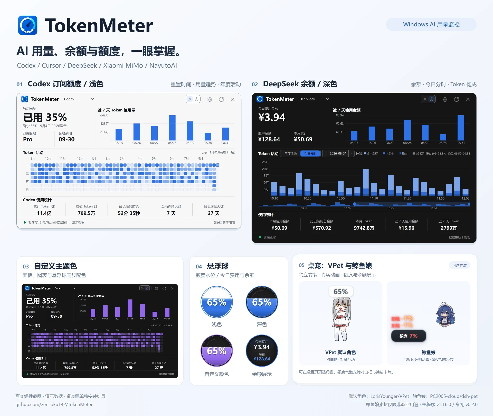
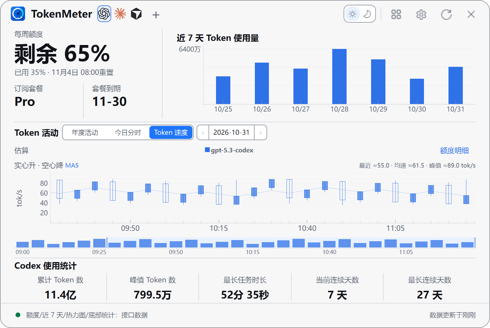
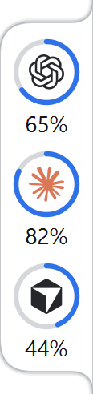

<p align="center">
  <a href="./README.md">简体中文</a> |
  <a href="./README.en.md">English</a> |
  <a href="./README.zh-TW.md">繁體中文</a> |
  <a href="./README.ja.md">日本語</a> |
  <a href="./README.ko.md">한국어</a>
</p>

# TokenMeter — Windows AI Token 用量与订阅额度监控工具

<p align="center">
  <a href="https://github.com/zensoku142/TokenMeter/stargazers"></a>
  <a href="https://github.com/zensoku142/TokenMeter/releases/latest"></a>
  <a href="https://github.com/zensoku142/TokenMeter/releases"></a>
  <a href="https://github.com/zensoku142/TokenMeter/actions/workflows/ci.yml"></a>
</p>

<p align="center">
  <a href="https://github.com/zensoku142/TokenMeter/releases/latest"><strong>下载最新版</strong></a> ·
  <a href="https://github.com/zensoku142/TokenMeter/stargazers">如果有帮助，请点 Star</a> ·
  <a href="https://github.com/zensoku142/TokenMeter/discussions">反馈与讨论</a>
</p>

<p align="center">
  <strong>Windows AI 编程订阅额度、Token 用量与余额监控工具</strong><br>
  <sub>Codex · Claude · Cursor · DeepSeek · MiMo · NayutoAI</sub>
</p>

TokenMeter 是适用于 Windows 10/11 的轻量级 AI 用量监控工具，支持 6 个平台的订阅额度、重置时间、API 费用、余额与历史趋势，可通过悬浮球、轻底细环或桌宠常驻查看。

<table>
  <tr>
    <td align="center" width="46%"><a href="docs/images/readme-hero.webp"></a><br>产品总览</td>
    <td align="center" width="46%"><a href="site/assets/panel-token-speed.png"></a><br>Token 速度</td>
    <td align="center" width="8%"><a href="site/assets/light-ring.png"></a><br>轻底细环</td>
  </tr>
</table>

真实组件截图，使用演示数据；点击查看原图。[截图与来源](docs/images/readme/README.md)。

当前版本：**v1.17.2** · 桌宠扩展 **v0.3.2** · [产品官网（GitHub Pages）](https://zensoku142.github.io/TokenMeter/)

## 功能

- **额度与余额**：Codex / Claude Code / Cursor 订阅额度，DeepSeek / MiMo / NayutoAI 费用、余额与历史趋势；币种、积分和 Token 分开显示。
- **统计与速度**：Codex 今日分时，Codex / Claude / ZCode 本机日志统计、筛选与 Excel 导出；Codex / NayutoAI 支持模型输出速度。
- **总览与多账户**：多平台总览、置顶双平台看板；多账户默认关闭，开启后独立监控，不覆盖默认连接或 CLI 登录。
- **CC Switch**：启用多账户及 CC 连接，自动发现并后台刷新托管 Codex OAuth 账号；CC 负责续期与查询，断连保留缓存。
- **悬浮展示**：原有额度／余额悬浮球与轻底细环，支持拖动、缩放和贴边；细环可显示多平台、多账号，并调整顺序、颜色与宽度。
- **采集与提醒**：后台同步、失败退避、离线缓存、峰谷提示与 Cookie 获取；可选低额度、恢复、消耗预测、静默时段及 Codex 公开重置消息提醒。
- **外观与集成**：明暗／系统主题、调色、透明度、五种语言，平台搜索与收藏、开机自启、自动更新和数据迁移。

本机统计账户归属未知，不代表订阅额度或账单；速度估算含首字等待，数据不足时显示未知；社区重置消息不代表个人额度到账。

<details>
<summary>操作与连接说明</summary>

- 细环直接拖动可移动窗口，长按图标后上下拖动可排序，Ctrl＋滚轮调整宽度；来源在“采集与统计 → 同时获取”选择。
- 多账户和 CC 连接可分别关闭，重新开启沿用配置。CC 桥接依赖其内部命令；若已普通启动，请先从托盘完全退出一次再刷新。未配置 CC 时不提供独立多账号登录或续期。
- 消耗预测需同周期至少 10 分钟有效样本；恢复提醒需先开启低额度提醒，并以实际刷新为准。提醒状态跨重启保留；删除平台连接保留 CLI 登录和历史。

</details>

## 安装与配置

需要 Windows 10 / 11 和至少一个受支持的平台账户。

1. 从 [GitHub Releases](https://github.com/zensoku142/TokenMeter/releases/latest) 下载 `TokenMeter-Setup-vX.Y.Z-x64.exe`，安装后启动；校验文件为 `SHA256SUMS.txt`。
2. 点击悬浮球打开面板，在“设置”中选择平台。Codex / Cursor 可读取本机登录；DeepSeek 填写凭据或可选 API Key，MiMo 可一键获取 Cookie，NayutoAI 使用其平台凭据。
3. 设置自动保存，默认每 60 秒刷新。主题和语言位于“外观”，启动与贴边选项位于“悬浮与启动”。

> 数据依赖平台接口与登录状态，接口变化或风控可能暂时影响获取。请仅使用自己的账户凭据。

主面板和“设置 → 账户连接”共用品牌卡片选择器，支持名称搜索与已配置/常用筛选。Claude Code 默认只读本机 OAuth 登录，也可手动填写 Access Token；显式指定[状态栏快照文件](docs/provider-support-research-2026-09-05.md#个人订阅官方状态栏快照)仍优先使用快照。平台未提供的明细显示为不可用；本程序不自动续期或改写其他客户端的 OAuth 登录。

[Claude Code 接入来源](docs/provider-support-research-2026-09-05.md#个人订阅官方状态栏快照)

## 桌宠（可选）

<table>
  <tr>
    <td align="center" width="33%"><a href="docs/images/readme/pet-vpet-current.png"></a><br>萝莉斯（VPet）</td>
    <td align="center" width="33%"><a href="site/assets/pet-whale-transparent.png"></a><br>鲸鱼娘</td>
    <td align="center" width="34%"><a href="site/assets/pet-bailong.png"></a><br>小龙娘</td>
  </tr>
</table>

在“设置 → 桌宠”下载角色并启用，无需另装 .NET；可替代悬浮球或同时显示，关闭后恢复球体。

- **角色**：萝莉斯（VPet）待机、走动与互动；[鲸鱼娘](https://github.com/PC2005-cloud/dsh-pet)动作与额度反馈、余额卡片；[小龙娘](pet_host/bailong/README.md)含 35 段动画和自主移动。
- **交互**：拖动、Ctrl＋滚轮缩放、主题气泡及默认关闭的喝水／休息提醒；双击气泡打开面板。支持多开，各实例独立保存位置与显示账户。
- **管理**：角色可单独安装、删除或设为默认，扩展可独立更新（正式／体验通道）；删除最后一个角色卸载宿主，主程序退出时一同退出。

小龙娘尺寸 80–320，其余 160–320；桌宠菜单为中文。不含养成、投喂、工作、Steam、联机或 AI 对话；鲸鱼娘素材仅限非商业用途。[开发说明](pet_host/README.md) · [来源与授权](pet_host/THIRD_PARTY_NOTICES.md)。

## 数据、隐私与更新

- 数据默认保存在 `安装目录\data`，可在设置中迁移。旧版升级采用复制迁移，保留原目录；历史缓存在本地 SQLite。
- API Key、Bearer Token 与 Cookie 存入 Windows 凭据管理器，不写入配置或日志；桌宠只接收展示字段，不接收凭据。
- 更新包通过 SHA256 校验后安装，保留数据与快捷方式。默认卸载也保留 `data`，请确认不再需要后再手动删除。SHA256 校验不等同于发布签名。

## 从源码运行

需要 Python 3.11+。源码版与安装版共用单实例限制，请先退出已运行的 TokenMeter。

```powershell
git clone https://github.com/zensoku142/TokenMeter.git
cd TokenMeter
python -m venv .venv
.\.venv\Scripts\Activate.ps1
python -m pip install --upgrade "pip>=26.1.2"
python -m pip install -r requirements.txt
python main.py
```

<details>
<summary>开发、测试与构建</summary>

```powershell
python -m pip install -r requirements-dev.txt
python -m pytest -q
python -m ruff check .
pyright
python -m pip install -r requirements-build.txt
python scripts/build_release.py
```

Qt 测试需要可用的 Windows 桌面会话；生成安装器需要 Inno Setup。桌宠构建需要 .NET SDK 8+，详见 [桌宠开发说明](pet_host/README.md)。

[项目结构](docs/PROJECT_STRUCTURE.md) · [配置示例](examples/config.example.py)（无需复制为 `config.py`）

</details>

## 常见问题

- 无窗口：检查系统托盘，并确认未重复启动。
- 凭据失效或请求受限：更新登录 / Cookie，或等待后再刷新。
- 数据异常：查看当前数据目录的 `TokenSpider.log`；提交反馈前请移除敏感信息。

## 版本

主程序 `1.17.2`，可选桌宠扩展 `0.3.2`。更新记录与校验文件见 [GitHub Releases](https://github.com/zensoku142/TokenMeter/releases)。

## 许可与致谢

TokenMeter 自有代码采用 [MIT License](LICENSE)。

桌宠核心及默认角色、动画来源于 [LorisYounger/VPet](https://github.com/LorisYounger/VPet)，感谢上游作者及贡献者。核心采用 [Apache-2.0](third_party/VPet/LICENSE)；角色与动画版权归虚拟主播模拟器制作组所有，适用单独授权，不属于本项目的 MIT 授权范围。详见 [第三方声明](pet_host/THIRD_PARTY_NOTICES.md)。
