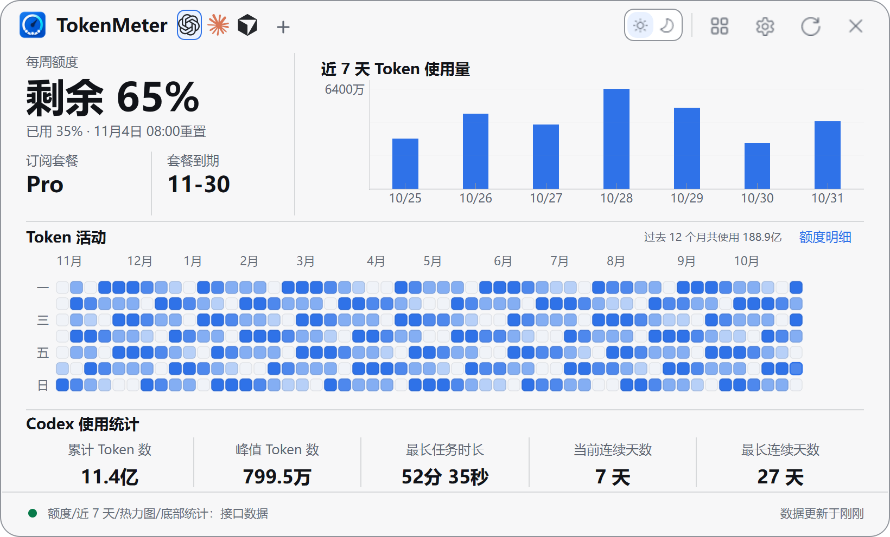
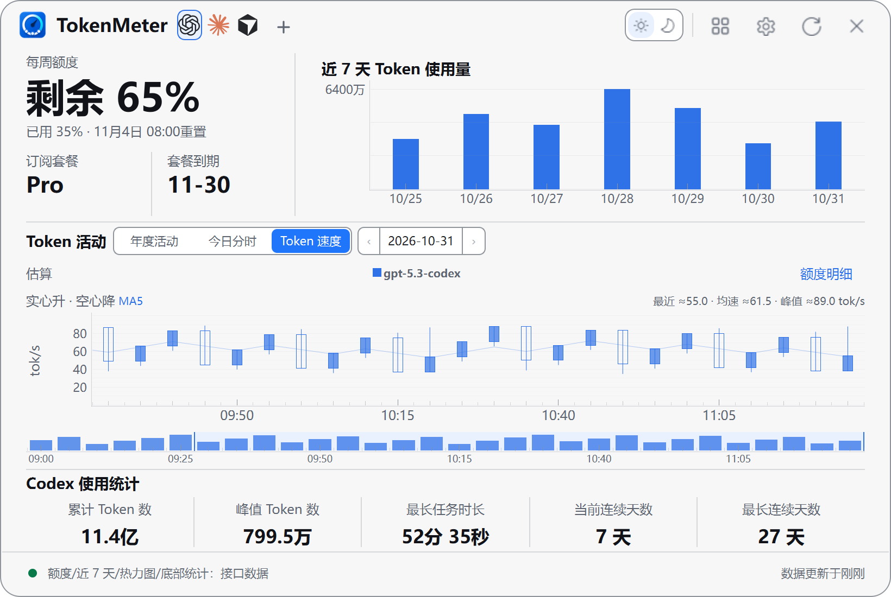
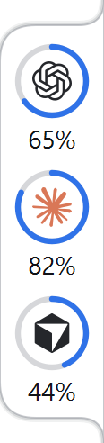

<p align="center">
  <a href="./README.md">简体中文</a> |
  <a href="./README.en.md">English</a> |
  <a href="./README.zh-TW.md">繁體中文</a> |
  <a href="./README.ja.md">日本語</a> |
  <a href="./README.ko.md">한국어</a>
</p>

# TokenMeter — Windows AI Token 用量与订阅额度监控工具

<p align="center">
  <a href="https://github.com/zensoku142/TokenMeter/stargazers"></a>
  <a href="https://github.com/zensoku142/TokenMeter/releases/latest"></a>
  <a href="https://github.com/zensoku142/TokenMeter/releases"></a>
  <a href="https://github.com/zensoku142/TokenMeter/actions/workflows/ci.yml"></a>
</p>

<p align="center">
  <a href="https://github.com/zensoku142/TokenMeter/releases/latest"><strong>下载最新版</strong></a> ·
  <a href="https://github.com/zensoku142/TokenMeter/stargazers">如果有帮助，请点 Star</a> ·
  <a href="https://github.com/zensoku142/TokenMeter/discussions">反馈与讨论</a>
</p>

<p align="center">
  <strong>Windows AI 编程订阅额度、Token 用量与余额监控工具</strong><br>
  <sub>Codex · Claude · Cursor · DeepSeek · MiMo · NayutoAI</sub>
</p>

<p align="center">
  <a href="site/assets/panel-light.png"></a><br>
  <a href="site/assets/panel-token-speed.png"></a><br>
  
  
</p>

真实组件截图，使用演示数据。[查看原图与来源](docs/images/readme/README.md)。

TokenMeter 是一款适用于 Windows 10/11 的轻量级 AI 用量与额度监控工具，提供 6 个独立平台入口，按平台能力展示订阅额度、重置时间、API 费用、账户余额和历史趋势。各平台的数据范围及权限要求不同，具体支持范围见下方配置指南。

当前版本：**v1.17.0** · 桌宠扩展 **v0.3.1** · [产品官网（GitHub Pages）](https://zensoku142.github.io/TokenMeter/)


## 功能

- **Codex 今日分时**：按本机会话日志的记录时间展示缓存命中、新增输入和输出 Token，支持模型提示、历史日期和增量刷新。统计仅包含所选目录的本机记录，账号归属未知，不代表订阅额度或实际账单。
- **Token 速度**：在 Codex 和 NayutoAI 面板查看按模型和时间分组的输出速度。速度根据有效请求的输出 Token 与耗时估算，包含首字等待；可用数据不足时显示未知。
- **多平台总览**：从顶部“切换视图”进入，同屏查看已配置平台的独立额度、余额与最后成功更新时间；打开后自动逐个采集，页面可见时每分钟更新，遵守失败退避并跳过刚刷新过的平台。离开后停止额外轮询，失效连接可从对应卡片进入账户设置。
- **独立账户档案**：在“设置 → 多账户”为同一平台保存多个连接，“账户连接”页也提供管理入口。支持添加、编辑、删除和独立监控；可关闭“启用多账户”暂停全部档案采集与展示，或单独关闭“连接 CC Switch”停止 CC 连接与自动启动，重新开启沿用原配置。明确指定凭据或登录路径，秘密字段保存在 Windows 凭据管理器。档案不覆盖默认连接或 CLI 登录，迟到请求按档案版本和实际账号身份校验；额度通知可定位对应档案。
- **CC Switch Codex 多账号额度**：已在 CC Switch 配置托管 Codex OAuth 账号时，程序启动即自动发现账号并后台采集，之后每分钟检查更新并遵守失败退避，不依赖打开面板或启用桌宠。多账户页、细环和桌宠共用账号结果及请求状态，打开页面可直接显示缓存，不重复发起同账号请求。程序重启后自动恢复连接，端口记录丢失时也会寻找已有本机桥接，无需每次手动连接。CC 未运行时由采集自动启动；续期和查询均交给 CC Switch，TokenMeter 只保存绑定和额度缓存，临时断连时保留上次成功额度并标注缓存。若 CC 已通过普通方式启动且未启用桥接，首次需从托盘完全退出一次，再刷新即可自动启动。未配置 CC 时不提供独立多账号登录或续期。桥接依赖 CC Switch 的 Tauri 内部命令，版本变化可能需要适配。
- **本机统计与导出**：从顶部“切换视图”打开后自动读取 Codex（含归档）、Claude 和 ZCode 本机用量记录，先显示缓存，再后台更新；页面可见时每分钟增量刷新。支持 Top 排行、每日模型对比、图表/表格切换、自定义日期和项目筛选，并可后台导出 Excel（`.xlsx`），包含统计汇总、用量明细与口径说明。可显式选择已可访问的 WSL 目录，不启动 WSL。统计仅代表所选本机记录，账户归属未知，不作为订阅额度或实际账单。

- **品牌识别与快速切换**：离线品牌 SVG、纯图标快捷入口和“＋”管理面板，支持中英文名称搜索、已配置筛选和常用收藏。点击星形或按 `Ctrl+D` 收藏；当前平台始终显示，高亮标识选中状态。Nayuto 暂用通用标识。
- **平台配置管理**：每个已配置平台卡片右下角提供“删除”，清除本应用保存的凭据并停止监控，保留本机 CLI 登录和历史记录。已移除平台可从“全部平台”重新启用，API 凭据需重新填写。
- **订阅额度**：Codex、Claude Code、Cursor。“额度明细”展示平台实际提供的窗口、账户指标和数据来源。
- **API 用量**：DeepSeek / MiMo / NayutoAI 的费用、余额与历史趋势；不同币种分别展示，积分不折算为金额或 Token。
- **悬浮展示**：保留原有悬浮球，另可选择“轻底细环”，支持单平台、多平台和多账号常驻展示、贴边弧线与吸附动画；纵向拖动排序、横向拖动窗口，顺序自动保存。图标保留原色，额度环默认跟随主题，也可独立设置颜色。展示来源统一在“采集与统计 → 同时获取”选择。
- **Codex 公开重置动态**：细环悬停详情显示 TIBO 的公开预告、参考倒计时或距上次公开重置的时长；可开启新消息提醒。公开动态来自社区，不代表个人账号额度到账。
- **双平台看板**：顶部“切换视图”可打开独立置顶小窗口，同时查看两个平台的默认连接。选择会保留，复用总览刷新队列；每个平台优先显示最紧张的额度窗口，其余内容可进入详情查看。
- **外观与语言**：浅色、深色及系统主题，可调整主题色和透明度；支持简中、繁中、英语、日语、韩语。
- **采集与缓存**：默认仅刷新当前平台，可选后台同步；限流或网络故障时自动退避，手动刷新可主动重试。低额度提醒默认关闭，可在“采集与统计”中启用。支持离线缓存、DeepSeek 峰谷提示与 MiMo Cookie 获取及续期。

- **桌面集成**：开机自启、自动更新、数据目录迁移，以及可选的多角色桌宠扩展。

“采集与统计”还可启用额度消耗预测、恢复提醒和额度通知静默时段。预测至少需要 10 分钟的有效同周期样本，只显示估计；恢复提醒需先启用低额度提醒，并以实际刷新确认的恢复为准。提醒状态保存在本机，重启后不会重复通知同一低额度状态。

本机统计的图例可点击显示/隐藏模型，右键可只看该模型；悬停使用与今日分时相同的分项提示，滚轮缩放、拖动横移，“重置视图”恢复全部模型和坐标范围。表格悬停和导出保留精确 Token 数。日志目录和导出入口位于统计页右上角“更多操作”。

## 安装与配置

需要 Windows 10 / 11 和至少一个受支持的平台账户。

1. 从 [GitHub Releases](https://github.com/zensoku142/TokenMeter/releases/latest) 下载 `TokenMeter-Setup-vX.Y.Z-x64.exe`，安装后启动；校验文件为 `SHA256SUMS.txt`。
2. 点击悬浮球打开面板，在“设置”中选择平台。Codex / Cursor 可读取本机登录；DeepSeek 填写凭据或可选 API Key，MiMo 可一键获取 Cookie，NayutoAI 使用其平台凭据。
3. 设置自动保存，默认每 60 秒刷新。主题和语言位于“外观”，启动与贴边选项位于“悬浮与启动”。

> 数据依赖平台接口与登录状态，接口变化或风控可能暂时影响获取。请仅使用自己的账户凭据。

主面板和“设置 → 账户连接”共用品牌卡片选择器，支持名称搜索与已配置/常用筛选。Claude Code 默认只读本机 OAuth 登录，也可手动填写 Access Token；显式指定[状态栏快照文件](docs/provider-support-research-2026-09-05.md#个人订阅官方状态栏快照)仍优先使用快照。平台未提供的明细显示为不可用；本程序不自动续期或改写其他客户端的 OAuth 登录。

[Claude Code 接入来源](docs/provider-support-research-2026-09-05.md#个人订阅官方状态栏快照)

## 桌宠（可选）

主安装包不含桌宠。在“设置 → 桌宠”下载扩展，完整安装后再启用；无需另装 .NET。启用后默认由桌宠替代悬浮球；开启“同时显示悬浮球”可让两者一起显示，设置自动保存并立即生效。关闭或卸载桌宠后恢复球体，不影响账户与面板。

- 支持轻触互动、拖动缩放、自主活动和贴边额度气泡；双击气泡打开用量面板。
- 桌宠可选萝莉斯、[鲸鱼娘](https://github.com/PC2005-cloud/dsh-pet)或[小龙娘](pet_host/bailong/README.md)；小龙娘完整接入 35 段动画，使用同一桌宠宿主与用量气泡，不包含 AI 对话和历史会话。鲸鱼娘素材仅限非商业用途，已安装角色可设为默认。
- 桌宠更新可独立选择正式版或体验版通道，检查后安装该通道的最新兼容版本。
- 支持只下载所选角色；安装扩展后可单独添加或删除 VPet、鲸鱼娘和小龙娘资源。删除最后一个角色时同时卸载共用宿主。
- 可在桌宠右键菜单即时增开已安装角色，并单独关闭某只桌宠；额外实例独立记住位置。
- 每只桌宠的右键“显示来源”可独立选择跟随主程序、已配置平台的默认账户，或已保存的账户档案；各实例展示对应账户的用量。
- 右键菜单可设置额度气泡展示方式，以及默认关闭的喝水、休息提醒；桌宠菜单目前为中文。
- 鼠标悬停桌宠时按住 Ctrl 滚动滚轮即可放大或缩小；小龙娘的缩放范围为 80–320，其余角色为 160–320。
- 主程序 v1.17.0 配合桌宠 v0.3.1，可同步额度气泡与独立额度窗口的明暗底色、文字和低额度提示色；旧版仍可连接。
- 精简版不含投喂、工作、养成、Steam 或联机功能。扩展可单独更新，主程序退出时桌宠一同退出。

实现细节和独立构建见 [桌宠开发说明](pet_host/README.md)，使用素材前请阅读 [来源与授权](pet_host/THIRD_PARTY_NOTICES.md)。


鲸鱼娘素材来源：[PC2005-cloud/dsh-pet](https://github.com/PC2005-cloud/dsh-pet)，仅限非商业用途。

## 数据、隐私与更新

- 数据默认保存在 `安装目录\data`，可在设置中迁移。旧版升级采用复制迁移，保留原目录；历史缓存在本地 SQLite。
- API Key、Bearer Token 与 Cookie 存入 Windows 凭据管理器，不写入配置或日志；桌宠只接收展示字段，不接收凭据。
- 更新包通过 SHA256 校验后安装，保留数据与快捷方式。默认卸载也保留 `data`，请确认不再需要后再手动删除。SHA256 校验不等同于发布签名。

## 从源码运行

需要 Python 3.11+。源码版与安装版共用单实例限制，请先退出已运行的 TokenMeter。

```powershell
git clone https://github.com/zensoku142/TokenMeter.git
cd TokenMeter
python -m venv .venv
.\.venv\Scripts\Activate.ps1
python -m pip install --upgrade "pip>=26.1.2"
python -m pip install -r requirements.txt
python main.py
```

<details>
<summary>开发、测试与构建</summary>

```powershell
python -m pip install -r requirements-dev.txt
python -m pytest -q
python -m ruff check .
pyright
python -m pip install -r requirements-build.txt
python scripts/build_release.py
```

Qt 测试需要可用的 Windows 桌面会话；生成安装器需要 Inno Setup。桌宠构建需要 .NET SDK 8+，详见 [桌宠开发说明](pet_host/README.md)。

[项目结构](docs/PROJECT_STRUCTURE.md) · [配置示例](examples/config.example.py)（无需复制为 `config.py`）

</details>

## 常见问题

- 无窗口：检查系统托盘，并确认未重复启动。
- 凭据失效或请求受限：更新登录 / Cookie，或等待后再刷新。
- 数据异常：查看当前数据目录的 `TokenSpider.log`；提交反馈前请移除敏感信息。

## 版本

主程序 `1.17.0`，可选桌宠扩展 `0.3.1`。更新记录与校验文件见 [GitHub Releases](https://github.com/zensoku142/TokenMeter/releases)。

## 许可与致谢

TokenMeter 自有代码采用 [MIT License](LICENSE)。

桌宠核心及默认角色、动画来源于 [LorisYounger/VPet](https://github.com/LorisYounger/VPet)，感谢上游作者及贡献者。核心采用 [Apache-2.0](third_party/VPet/LICENSE)；角色与动画版权归虚拟主播模拟器制作组所有，适用单独授权，不属于本项目的 MIT 授权范围。详见 [第三方声明](pet_host/THIRD_PARTY_NOTICES.md)。
