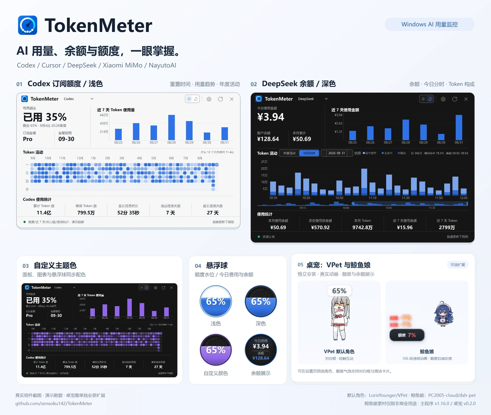
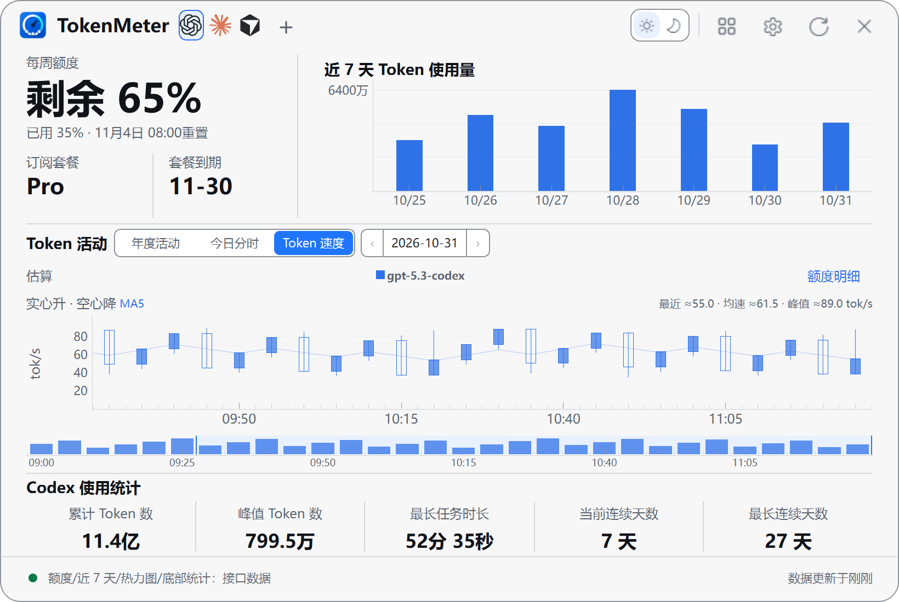
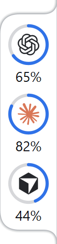

<p align="center">
  <a href="./README.md">简体中文</a> |
  <a href="./README.en.md">English</a> |
  <a href="./README.zh-TW.md">繁體中文</a> |
  <a href="./README.ja.md">日本語</a> |
  <a href="./README.ko.md">한국어</a>
</p>

# TokenMeter — Windows AI Token 用量與訂閱額度監控工具

<p align="center">
  <a href="https://github.com/zensoku142/TokenMeter/stargazers"></a>
  <a href="https://github.com/zensoku142/TokenMeter/releases/latest"></a>
  <a href="https://github.com/zensoku142/TokenMeter/releases"></a>
  <a href="https://github.com/zensoku142/TokenMeter/actions/workflows/ci.yml"></a>
</p>

<p align="center">
  <a href="https://github.com/zensoku142/TokenMeter/releases/latest"><strong>下載最新版</strong></a> ·
  <a href="https://github.com/zensoku142/TokenMeter/stargazers">如果有幫助，請點 Star</a> ·
  <a href="https://github.com/zensoku142/TokenMeter/discussions">意見與討論</a>
</p>

<p align="center">
  <strong>Windows AI Token 用量、費用與餘額監控工具</strong><br>
  <sub>Codex · Claude · Cursor · DeepSeek · MiMo · NayutoAI</sub>
</p>

TokenMeter 是適用於 Windows 10/11 的輕量級 AI 用量監控工具，支援 6 個平台的訂閱額度、重設時間、API 費用、餘額與歷史趨勢，可透過懸浮球、輕底細環或桌寵常駐查看。

<table>
  <tr>
    <td align="center" width="46%"><a href="docs/images/readme-hero.webp"></a><br>產品總覽</td>
    <td align="center" width="46%"><a href="site/assets/panel-token-speed.png"></a><br>Token 速度</td>
    <td align="center" width="8%"><a href="site/assets/light-ring.png"></a><br>輕底細環</td>
  </tr>
</table>

真實元件截圖，使用簡體中文介面與示範資料；點擊查看原圖。[截圖與來源](docs/images/readme/README.md)。

目前版本：**v1.17.2** · 桌寵 **v0.3.2** · [GitHub Pages](https://zensoku142.github.io/TokenMeter/)

## 功能

- **額度與餘額**：Codex / Claude Code / Cursor 訂閱額度，DeepSeek / MiMo / NayutoAI 費用、餘額與歷史趨勢；幣別、積分和 Token 分開顯示。
- **統計與速度**：Codex 今日分時，Codex / Claude / ZCode 本機日誌統計、篩選與 Excel 匯出；Codex / NayutoAI 支援模型輸出速度。
- **總覽與多帳戶**：多平台總覽、置頂雙平台看板；多帳戶預設關閉，開啟後獨立監控，不覆蓋預設連線或 CLI 登入。
- **CC Switch**：啟用多帳戶及 CC 連線，自動發現並在背景更新託管 Codex OAuth 帳號；CC 負責續期與查詢，斷線保留快取。
- **懸浮顯示**：原有額度／餘額懸浮球與輕底細環，支援拖曳、縮放和貼邊；細環可顯示多平台、多帳號，並調整順序、顏色與寬度。
- **擷取與提醒**：背景同步、失敗退避、離線快取、峰谷提示與 Cookie 取得；可選低額度、恢復、消耗預測、靜默時段及 Codex 公開重設消息提醒。
- **外觀與整合**：明暗／系統主題、調色、透明度、五種語言，平台搜尋與收藏、開機啟動、自動更新和資料遷移。

本機統計帳戶歸屬未知，不代表訂閱額度或帳單；速度估算含首字等待，資料不足時顯示未知；社群重設消息不代表個人額度已恢復。

<details>
<summary>操作與連線說明</summary>

- 直接拖曳細環可移動視窗，長按圖示後上下拖曳可排序，Ctrl＋滾輪調整寬度；來源在「擷取與統計 → 同時取得」選擇。
- OpenAI API 細環顯示組織的美元可用餘額，圓環下緣的 `API` 隨主題切換顏色。已設定並啟用 Codex 時，點擊該細環可開啟 Codex 用量面板。
- 多帳戶和 CC 連線可分別關閉，重新開啟沿用設定。CC 橋接依賴其內部命令；若已一般啟動，請先從系統匣完全結束一次再更新。未設定 CC 時不提供獨立多帳號登入或續期。
- 消耗預測需同週期至少 10 分鐘有效樣本；恢復提醒需先開啟低額度提醒，並以實際更新為準。提醒狀態跨重啟保留；移除平台連線保留 CLI 登入與歷史。

</details>

## 安裝與設定

需要 Windows 10 / 11 和至少一個支援的平台帳戶。

1. 從 [GitHub Releases](https://github.com/zensoku142/TokenMeter/releases/latest) 下載並安裝 `TokenMeter-Setup-vX.Y.Z-x64.exe`；校驗檔為 `SHA256SUMS.txt`。
2. 點擊懸浮球，在「設定」選擇平台。Codex / Cursor 可讀取本機登入；DeepSeek 填寫憑據或選用的 API Key，MiMo 可一鍵取得 Cookie，NayutoAI 使用其平台憑據。
3. 設定自動儲存，預設每 60 秒更新。主題和語言位於「外觀」，啟動與貼邊選項位於「懸浮與啟動」。

> 資料依賴平台介面與登入狀態，介面變更或風控可能暫時影響取得。請只使用自己的帳戶憑據。

## 桌寵（選用）

<table>
  <tr>
    <td align="center" width="33%"><a href="docs/images/readme/pet-vpet-current.png"></a><br>蘿莉斯（VPet）</td>
    <td align="center" width="33%"><a href="site/assets/pet-whale-transparent.png"></a><br>鯨魚娘</td>
    <td align="center" width="34%"><a href="site/assets/pet-bailong.png"></a><br>小龍娘</td>
  </tr>
</table>

在「設定 → 桌寵」下載角色並啟用，無需另裝 .NET；可取代懸浮球或同時顯示，停用後恢復球體。

- **角色**：蘿莉斯（VPet）待機、走動與互動；[鯨魚娘](https://github.com/PC2005-cloud/dsh-pet)動作與額度回饋、餘額卡片；[小龍娘](pet_host/bailong/README.md)含 35 段動畫和自主移動。
- **互動**：拖曳、Ctrl＋滾輪縮放、主題氣泡及預設關閉的喝水／休息提醒；按兩下氣泡開啟面板。支援多開，各執行個體獨立保存位置與顯示帳戶。
- **管理**：角色可單獨安裝、移除或設為預設，擴充套件可獨立更新（正式／體驗通道）；移除最後一個角色時解除安裝宿主，主程式結束時一同結束。

小龍娘尺寸 80–320，其餘 160–320；桌寵選單為簡體中文。不含養成、餵食、工作、Steam、連線或 AI 對話；鯨魚娘素材僅限非商業用途。[開發說明](pet_host/README.md) · [來源與授權](pet_host/THIRD_PARTY_NOTICES.md)。

## 資料、隱私與更新

- 資料預設存於 `安裝目錄\data`，可在設定中遷移。舊版升級採複製遷移，保留原目錄；歷史快取於本機 SQLite。
- API Key、Bearer Token 與 Cookie 存入 Windows 認證管理員，不寫入設定或記錄檔；桌寵只接收顯示欄位，不接收憑據。
- 更新套件通過 SHA256 驗證後安裝，保留資料與捷徑。預設解除安裝也保留 `data`，請確認不再需要後再手動刪除。SHA256 驗證不等同於發布簽章。

## 從原始碼執行

需要 Python 3.11+。原始碼版與安裝版共用單一執行個體限制，請先結束已執行的 TokenMeter。

```powershell
git clone https://github.com/zensoku142/TokenMeter.git
cd TokenMeter
python -m venv .venv
.\.venv\Scripts\Activate.ps1
python -m pip install --upgrade "pip>=26.1.2"
python -m pip install -r requirements.txt
python main.py
```

<details>
<summary>開發、測試與建置</summary>

```powershell
python -m pip install -r requirements-dev.txt
python -m pytest -q
python -m ruff check .
pyright
python -m pip install -r requirements-build.txt
python scripts/build_release.py
```

Qt 測試需要可用的 Windows 桌面工作階段；產生安裝程式需要 Inno Setup。桌寵建置需要 .NET SDK 8+，詳見 [桌寵開發說明](pet_host/README.md)。

[專案結構](docs/PROJECT_STRUCTURE.md) · [設定範例](examples/config.example.py)（無需複製為 `config.py`）

</details>

## 常見問題

- 無視窗：檢查系統匣，並確認未重複啟動。
- 憑據失效或請求受限：更新登入 / Cookie，或稍後再更新資料。
- 資料異常：查看目前資料目錄的 `TokenSpider.log`；回報問題前請移除敏感資訊。

## 版本

主程式 `1.17.2`，選用桌寵擴充套件 `0.3.2`。更新記錄與校驗檔見 [GitHub Releases](https://github.com/zensoku142/TokenMeter/releases)。

## 授權與致謝

TokenMeter 自有程式碼採用 [MIT License](LICENSE)。

桌寵核心及預設角色、動畫來自 [LorisYounger/VPet](https://github.com/LorisYounger/VPet)，感謝上游作者及貢獻者。核心採用 [Apache-2.0](third_party/VPet/LICENSE)；角色與動畫著作權歸虚拟主播模拟器制作组所有，適用單獨授權，不屬於本專案的 MIT 授權範圍。詳見 [第三方聲明](pet_host/THIRD_PARTY_NOTICES.md)。
